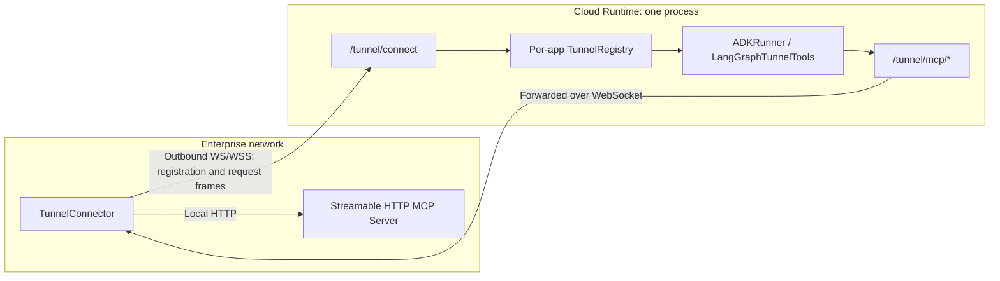

KsADK Tunnel connects MCP Servers inside an enterprise network to a cloud ADK Agent or custom LangGraph StateGraph through an **outbound** WebSocket. The enterprise side does not need to open an inbound port, and the Agent can discover and call tunneled tools according to the services online during execution.

<Callout type="warning" title="First-version boundaries">
The first version supports automatic injection into the root ADK Agent and explicit integration with a custom LangGraph StateGraph; the only supported protocol is Streamable HTTP MCP. The registry lives in one Runtime process, so deployment requires one worker and one replica, or a verified sticky-routing topology. WS/WSS forwarding through the actual gateway requires separate acceptance testing.
</Callout>

## How it works



1. The cloud KsADK Runtime mounts Tunnel routes from environment configuration.
2. The enterprise connector registers one or more MCP Servers, sending only names, protocols, and tool filters.
3. ADKRunner automatically injects `TunnelToolset` when it first loads the root ADK Agent, without importing the user's `root_agent` during app bootstrap. A custom LangGraph StateGraph instead calls `LangGraphTunnelTools` explicitly from its nodes.
4. ADK reads the currently online services during each subsequent tool enumeration; LangGraph reads them when its model and tool nodes execute. New services subsequently appear, and offline services are removed.
5. MCP requests travel through the in-process proxy and WebSocket to the connector, which calls the real on-prem service.

## Enable the cloud side

Tunnel is disabled by default. The first version supports the ADK Runtime and explicit custom StateGraph integration in the LangGraph Runtime. `KSADK_TUNNEL_TOKEN` is required when Tunnel is enabled; other Runtimes must not set the enable flag.

### Project-scoped configuration

From the project root, use `config set` to write the configuration to the current project's `.env`:

```bash title="bash"
agentengine config set \
  KSADK_ENABLE_TUNNEL=1 \
  KSADK_TUNNEL_TOKEN=<tunnel-token>

agentengine run . --port 8080
```

For an ADK or LangGraph project, you can also run `agentengine config` and enable Tunnel in the interactive wizard. The wizard reads the token through a password prompt and does not generate `KSADK_TUNNEL_SELF_URL`; for LangGraph, it also reminds you to integrate explicitly in a custom StateGraph. Tunnel is project-scoped and cannot be saved to the global configuration. Even with `--global`, these variables are only written to the current project and a notice is displayed.

For temporary local debugging, you can still use the shell directly:

```bash title="bash"
export KSADK_ENABLE_TUNNEL=1
export KSADK_TUNNEL_TOKEN=<tunnel-token>
ksadk web . --port 8080
```

### Code/Container deployment

The standard `agentengine deploy` and `agentengine launch` commands inject Tunnel settings from the project `.env`, the shell, or an explicit environment file. Precedence is `--env` / `--env-file` > shell > project `.env`. For example:

```bash title="bash"
agentengine deploy . --repackage
# Or build and deploy in one command:
agentengine launch . --no-cache
```

No extra rebuild option is needed for an initial build. If an older artifact might not contain the MCP Runtime dependencies, use `--repackage` or `--no-cache` instead of reusing that artifact.

For CI, or when deployment inputs should be reviewed explicitly, create an untracked `prod.env`:

```bash title="prod.env"
KSADK_ENABLE_TUNNEL=1
KSADK_TUNNEL_TOKEN=<tunnel-token>
```

```bash title="bash"
agentengine deploy . --env-file ./prod.env
```

Hot updates use environment-variable upserts. Removing a variable from the local `.env` does not delete the existing server-side value. Set `KSADK_ENABLE_TUNNEL=0` and redeploy to disable Tunnel; deploy a new value explicitly when rotating the token.

Standard entrypoints derive `KSADK_TUNNEL_SELF_URL` from the actual listening port. Set it explicitly only when a special deployment cannot derive it correctly:

```bash title="bash"
export KSADK_TUNNEL_SELF_URL=http://127.0.0.1:8080
```

This must be the loopback HTTP(S) base URL of the FastAPI app in the same process. It cannot contain credentials, a query, or a fragment. Do not reuse a self URL that only matches a local port as deployment configuration.

### Ingress gateway and connection URL

For cloud deployment, the outer ingress gateway must forward `/tunnel/connect` to the FastAPI instance running the KsADK Runtime and allow WebSocket Upgrade. Allowing ordinary Agent HTTP requests is not sufficient for Tunnel. If this path is not configured, is rejected by the gateway, or is handled as ordinary HTTP, the connector cannot reach the Agent and complete registration.

Without a path prefix, the complete cloud connection URL is:

```text
wss://<agent-host>/tunnel/connect
```

A complete example using a reserved domain is:

```text
wss://agent.example.com/tunnel/connect
```

If the external endpoint is `https://agent.example.com/gateway/agent-a`, the complete connection URL is:

```text
wss://agent.example.com/gateway/agent-a/tunnel/connect
```

For local plaintext testing, use `ws://127.0.0.1:8080/tunnel/connect`. `TunnelConnector.cloud_url` must contain the HTTP(S) or WS(S) **base URL**. The connector converts the scheme, preserves the base path and existing query, and appends `/tunnel/connect`. Do not pass a complete URL that already contains `/tunnel/connect` as `cloud_url`, or the path will be appended twice.

By default, the Tunnel token is sent in the WebSocket handshake header `Authorization: Bearer <tunnel-token>`. The URL contains no token, and the Agent name is sent as `register.agent` in the first frame. If the outer gateway already consumes `Authorization`, pass the gateway credential through `TunnelConnector.extra_headers` and send the Tunnel token as a URL-encoded query parameter instead:

```text
wss://<agent-host>/<base-path>/tunnel/connect?token=<url-encoded-tunnel-token>
```

Without a base path, use `wss://<agent-host>/tunnel/connect?token=<url-encoded-tunnel-token>`. The gateway must preserve the required Authorization header, query parameters, and WebSocket Upgrade, and its idle timeout, maximum frame size, and long-lived connection behavior must be validated. Expose only `/tunnel/connect` as needed. `/tunnel/mcp/*` is the Runtime's internal loopback proxy and must not be exposed publicly just to establish a connector. `/tunnel/servers` is not required for registration; expose and authenticate it separately only when external online-service queries are needed.

### Agent name

The `agent` value used during connector registration is the Agent name detected by KsADK:

- Prefer `name` from `agentengine.yaml` when explicitly configured.
- Otherwise, use the name shown in detection output.
- It can differ from `root_agent.name` in ADK code; use the CLI detection result as the reference.
- In a custom LangGraph StateGraph, `LangGraphTunnelTools(agent_name=...)` must match the name detected for the current app.

The cloud side only allows registration to an Agent name allowed for the current app.

## Explicit integration for custom LangGraph StateGraphs

The public import is `from ksadk.tunnel.langgraph import LangGraphTunnelTools`; `from ksadk.tunnel import LangGraphTunnelTools` is also supported. During graph execution, the standard KsADK Runtime automatically supplies the current app's registry, self URL, and internal proxy credential. You do not need to call `mount_tunnel`, create a registry, or handle the proxy token yourself.

`await tunnel.get_tools(tools=BUSINESS_TOOLS)` returns the business tools plus the currently online Tunnel tools. When Tunnel is disabled and no registry was explicitly supplied, it returns only the business tools. Tools are discovered independently for each online server; a discovery failure for one server does not hide tools from the others. Model-visible tool names are stable as `<server-alias>__<tool>`, such as `calculator__add`. `LocalServer.tool_filter` always uses original MCP tool names, such as `add`, rather than names with the namespace prefix.

<Callout type="warning" title="LangGraph first-version boundaries">
This phase supports only explicit integration from nodes in a custom `StateGraph`. It does not support `create_agent`, DeepAgents, or the legacy `create_react_agent`, and it does not automatically inject tools into arbitrary compiled graphs. `create_agent` and DeepAgents integration is left for a later phase; ADK retains automatic injection.
</Callout>

### Complete example

The following example can serve as the entry module for a custom LangGraph project. Configure the environment variables required by your model provider and replace `BUSINESS_TOOLS` with your existing business tools. The example contains no real credentials.

```python title="agent.py"
import os

from langchain_openai import ChatOpenAI
from langgraph.graph import MessagesState, StateGraph, START
from langgraph.prebuilt import ToolNode, tools_condition

from ksadk.tunnel.langgraph import LangGraphTunnelTools


# Replace with your existing LangChain business tools.
BUSINESS_TOOLS = []

model = ChatOpenAI(
    model=os.environ.get("OPENAI_MODEL_NAME", "my-model"),
    base_url=os.environ.get("OPENAI_BASE_URL"),
    api_key=os.environ.get("OPENAI_API_KEY"),
)
tunnel = LangGraphTunnelTools(agent_name="ops_agent")


async def current_tools():
    return await tunnel.get_tools(tools=BUSINESS_TOOLS)


async def model_node(state: MessagesState, config):
    reply = await model.bind_tools(await current_tools()).ainvoke(
        state["messages"], config=config
    )
    return {"messages": [reply]}


async def tools_node(state: MessagesState, config):
    return await ToolNode(await current_tools()).ainvoke(state, config=config)


def build_graph(*, checkpointer=None):
    graph = StateGraph(MessagesState)
    graph.add_node("model", model_node)
    graph.add_node("tools", tools_node)
    graph.add_edge(START, "model")
    graph.add_conditional_edges("model", tools_condition)
    graph.add_edge("tools", "model")
    return graph.compile(checkpointer=checkpointer)


def ksadk_graph_factory(*, checkpointer):
    return build_graph(checkpointer=checkpointer)


root_agent = build_graph()
```

Keep `agent_name` consistent with `name` in `agentengine.yaml`:

```yaml title="agentengine.yaml"
name: ops_agent
framework: langgraph
entry_point: agent.py
agent_variable: root_agent
```

Both the model node and the tool node call the same `current_tools()`: the model obtains the tools currently available for model binding through `model.bind_tools(await current_tools())`, and the tool node obtains the currently executable tools through `ToolNode(await current_tools())`. Both nodes are async. The graph's nodes and edges keep a fixed topology; Tunnel tools are not expanded statically when the graph is compiled.

Do not run `get_tools()` during module import or inside `build_graph()`, and do not cache the tool list across executions. The standard Runtime provides the app-owned binding only in the graph execution context. Calling too early would lack that context and would freeze a tool catalog that is meant to reflect online changes.

### Configuration and startup order

1. Install `ksadk[langgraph]` and `langchain-openai`; the `langgraph` extra already includes the required `langchain-mcp-adapters`. Configure the model provider environment variables and create the `agent.py` and `agentengine.yaml` files above.
2. Enable Tunnel and configure its token as described in “Project-scoped configuration” or “Code/Container deployment”, then start or restart the Runtime. The standard entrypoint mounts the routes and provides the binding during graph execution; deployment must still follow the single-worker, single-replica, or sticky-routing limits at the end of this guide.
3. After the Runtime is ready, start the connector and confirm that the required servers have registered. The first-version connector does not promise automatic reconnection. Restart the connector and register again after a Runtime restart or a disconnected connection.
4. Send a request that needs Tunnel tools. Each node execution enumerates the currently online services again without recompiling the graph. If no servers have registered when the model request starts, the model sees only the business tools available at that time.

### Migrate an existing LangGraph graph

- **Existing custom ReAct StateGraph**: preserve the graph topology and replace static model tool binding and `ToolNode` construction with the async `model_node` and `tools_node` wrappers from the example. Both nodes call the same `current_tools()`, and existing business tools are passed through `BUSINESS_TOOLS`.
- **Chat-node-only graph**: the current LangGraph project template has only a `chat` node and no `ToolNode`. Adding `bind_tools` to `chat` alone is insufficient. Follow the complete example to add an async tool node, a `tools_condition` conditional edge, and an edge from `tools` back to `model`, forming a complete tool-calling loop.

## Enterprise connector

Run the following example inside the enterprise network. `TUNNEL_TOKEN` is only the local environment variable read by this connector process, and its value must match the cloud `KSADK_TUNNEL_TOKEN`.

```python title="connector.py"
import asyncio
import os

from ksadk.tunnel import LocalServer, TunnelConnector


async def main():
    connector = TunnelConnector(
        cloud_url="https://agent.example.com",
        agent="ops_agent",
        token=os.environ["TUNNEL_TOKEN"],
        servers=[
            LocalServer(
                name="internal_docs",
                protocol="mcp",
                address="http://127.0.0.1:9000/mcp",
                tool_filter=["search"],
                headers={"Authorization": "Bearer <local-mcp-token>"},
            )
        ],
    )
    await connector.start()


asyncio.run(main())
```

`address`, `headers`, and `query` remain on the connector side. Registration messages and cloud `/tunnel/servers` responses do not include these local connection secrets.

The first-version `start()` does not promise automatic reconnection. When the process exits or the connection closes, outstanding local requests are cancelled and the cloud services are removed during the next tool enumeration.

## Authentication boundaries

| Credential | Purpose | Location |
| --- | --- | --- |
| Tunnel token | Authenticate connector registration at `/tunnel/connect` | Cloud Secret and connector configuration |
| Internal proxy credential | Authenticate `TunnelToolset` or `LangGraphTunnelTools` calls to `/tunnel/mcp/*` in the same process | Randomly generated by Runtime and held only in per-app tunnel state |
| Local MCP credential | Authenticate the connector to the real on-prem MCP Server | Only `LocalServer.headers` or `query` on the enterprise side |

The internal proxy credential requires no user configuration. The cloud side removes it after verification and never sends it to the connector or the on-prem MCP Server.

Listing online services also requires the Tunnel token:

```bash title="bash"
curl -H "Authorization: Bearer ${TUNNEL_TOKEN}" \
  "https://agent.example.com/tunnel/servers?agent=ops_agent"
```

### Separate gateway credentials from the Tunnel token

If the gateway already consumes `Authorization`, put the gateway credential in `extra_headers`; the Tunnel token is then sent as a correctly URL-encoded query parameter:

```python
connector = TunnelConnector(
    cloud_url="https://agent.example.com",
    agent="ops_agent",
    token=os.environ["TUNNEL_TOKEN"],
    extra_headers={"Authorization": "Bearer <gateway-token>"},
    servers=[...],
)
```

Never put real credentials in source code, documentation, logs, or deployment artifacts.

## Tool exposure and safety

- Use `tool_filter` to expose only necessary tools instead of exposing an entire privileged on-prem MCP Server to the model.
- Tunnel registration does not imply business approval. Existing tool approval, audit, and sandbox boundaries must still be configured independently.
- `/tunnel/mcp/*` and `/tunnel/servers` are authenticated and cannot be used as anonymous public proxies.
- A response-head timeout returns 504, a disconnected server returns 503, and a connector-side local request failure returns 502 if the response has not started.
- Cancellation and connector disconnects clean up pending requests. A mid-stream failure is not treated as a successful EOF.
- The `content` of ordinary tool results continues through the existing event stream; the first version does not promise complete projection of MCP `structuredContent`.
- The first version does not promise cold recovery of executions containing unfinished Tunnel ToolCalls. Ordinary MCP calls proxied through Tunnel do not guarantee exactly-once semantics. Reconcile external side effects before retrying or recovering, and make business tools idempotent or deduplicated as required.

## Deployment limits

1. **One process**: the process owning the WebSocket and the process executing the Agent must share the same per-app registry.
2. **One replica or sticky routing**: randomly load-balanced multi-replica deployment is unsupported.
3. **WebSocket gateway**: production acceptance must cover WS/WSS, custom headers, idle timeouts, and maximum frame sizes.
4. **Dynamic behavior**: ADK tool changes apply to subsequent turns and do not modify a turn that has already started. LangGraph enumerates again whenever a node calls `current_tools()` and does not rewrite a model response that has already been generated.
5. **Protocol and integration scope**: stdio MCP, generic non-MCP binary proxying, and automatic tool injection other than into the root ADK Agent are unsupported. LangGraph supports only the explicit custom StateGraph integration described above.
6. **State recovery**: the registry does not survive process restart, so connectors must register again.

Passing a local MCP smoke test is not proof of cloud E2E success. Before release, use an isolated environment to verify the actual gateway, WSS, both authentication layers, tool invocation, and disconnect behavior.
