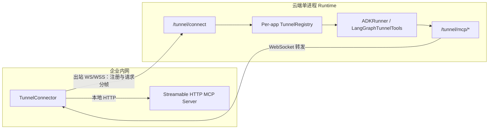

KsADK Tunnel 让企业内网的 MCP Server 通过**出站** WebSocket 连接到云端 ADK Agent 或自定义 LangGraph StateGraph。企业侧无需开放入站端口，Agent 可以按执行时的在线状态发现 Tunnel 中的工具并发起调用。

<Callout type="warning" title="首版边界">
首版支持根 ADK Agent 自动注入和自定义 LangGraph StateGraph 显式接入，协议仅支持 Streamable HTTP MCP。Registry 位于单个 Runtime 进程内，因此部署必须使用单 worker、单副本，或经过验证的 sticky 路由。真实网关的 WS/WSS 转发能力需要单独验收。
</Callout>

## 工作原理



1. 云端 KsADK Runtime 根据环境变量挂载 Tunnel 路由。
2. 企业侧 connector 注册一个或多个 MCP Server，只发送名称、协议和工具过滤条件。
3. ADKRunner 首次加载根 ADK Agent 时自动注入 `TunnelToolset`，不提前导入用户的 `root_agent`；自定义 LangGraph StateGraph 则在节点中显式调用 `LangGraphTunnelTools`。
4. ADK 在后续每轮工具枚举时读取当前在线服务；LangGraph 在模型和工具节点执行时读取。新服务随后出现，离线服务随后移除。
5. MCP 请求经本进程代理和 WebSocket 到达 connector，再由 connector 调用真实内网服务。

## 云端开启

Tunnel 默认关闭，首版支持 ADK Runtime，以及 LangGraph Runtime 中的自定义 StateGraph 显式接入。开启时必须提供 `KSADK_TUNNEL_TOKEN`，其他 Runtime 不应设置开启开关。

### 项目级配置

在项目根目录使用 `config set`，将配置写入当前项目的 `.env`：

```bash title="bash"
agentengine config set \
  KSADK_ENABLE_TUNNEL=1 \
  KSADK_TUNNEL_TOKEN=<tunnel-token>

agentengine run . --port 8080
```

ADK 和 LangGraph 项目也可以运行 `agentengine config`，在交互向导中启用 Tunnel。向导使用密码输入读取 token，不会生成 `KSADK_TUNNEL_SELF_URL`；选择 LangGraph 时会提示还需在自定义 StateGraph 中显式接入。Tunnel 是项目级能力，不支持保存到全局配置；即使搭配 `--global`，这些变量也只写入当前项目并显示提示。

临时本地调试仍可直接使用 shell：

```bash title="bash"
export KSADK_ENABLE_TUNNEL=1
export KSADK_TUNNEL_TOKEN=<tunnel-token>
ksadk web . --port 8080
```

### Code/Container 部署

标准 `agentengine deploy` 和 `agentengine launch` 会从项目 `.env`、shell 或显式环境文件注入 Tunnel 配置，优先级为 `--env` / `--env-file` > shell > 项目 `.env`。例如：

```bash title="bash"
agentengine deploy . --repackage
# 或使用一键构建部署：
agentengine launch . --no-cache
```

首次构建不需要额外的重建参数。如果可能已经存在未包含 MCP Runtime 依赖的旧制品，使用 `--repackage` 或 `--no-cache`，不要直接复用旧包。

CI 或希望显式审查部署输入时，可以创建不提交的 `prod.env`：

```bash title="prod.env"
KSADK_ENABLE_TUNNEL=1
KSADK_TUNNEL_TOKEN=<tunnel-token>
```

```bash title="bash"
agentengine deploy . --env-file ./prod.env
```

热更新使用环境变量 Upsert。只从本地 `.env` 删除变量不会删除服务端已有值；禁用 Tunnel 应显式设置 `KSADK_ENABLE_TUNNEL=0` 并重新部署，轮换 token 也应显式部署新值。

标准入口根据实际监听端口生成 `KSADK_TUNNEL_SELF_URL`。只有特殊部署无法正确推导时才显式设置：

```bash title="bash"
export KSADK_TUNNEL_SELF_URL=http://127.0.0.1:8080
```

该 URL 必须是本进程 FastAPI 应用的 loopback HTTP(S) base URL，不能包含凭证、query 或 fragment。不要把仅适用于本地端口的 self URL 当作可复用部署配置。

### 外层入口网关与建联 URL

云端部署时，外层入口网关必须把 `/tunnel/connect` 转发到运行 KsADK Runtime 的 FastAPI 实例，并允许 WebSocket Upgrade。只放行普通 Agent HTTP 请求并不代表 Tunnel 可用；该路径未配置、被网关拒绝或被当作普通 HTTP 处理时，connector 无法连接到 Agent 并完成注册。

无路径前缀时，完整云端建联 URL 为：

```text
wss://<agent-host>/tunnel/connect
```

例如使用保留域名表示的完整地址：

```text
wss://agent.example.com/tunnel/connect
```

如果外部入口是 `https://agent.example.com/gateway/agent-a`，完整建联 URL 为：

```text
wss://agent.example.com/gateway/agent-a/tunnel/connect
```

本地明文测试使用 `ws://127.0.0.1:8080/tunnel/connect`。`TunnelConnector.cloud_url` 应填写 HTTP(S) 或 WS(S) **base URL**，connector 会转换 scheme、保留 base path 和已有 query，并自动追加 `/tunnel/connect`。不要把已经包含 `/tunnel/connect` 的完整地址再次传给 `cloud_url`，否则会重复拼接该路径。

默认情况下，Tunnel token 通过 WebSocket 握手头 `Authorization: Bearer <tunnel-token>` 传递，URL 不包含 token，Agent 名称通过首帧 `register.agent` 传递。当外层网关已经占用 `Authorization` 时，网关凭证通过 `TunnelConnector.extra_headers` 传递，Tunnel token 改用经过 URL 编码的 query 参数：

```text
wss://<agent-host>/<base-path>/tunnel/connect?token=<url-encoded-tunnel-token>
```

无 base path 时对应为 `wss://<agent-host>/tunnel/connect?token=<url-encoded-tunnel-token>`。网关需要保留所需的 Authorization header、query 和 WebSocket Upgrade，并验证 idle timeout、最大帧大小及长连接行为。只应按需开放 `/tunnel/connect`；`/tunnel/mcp/*` 是 Runtime 内部 loopback 代理，不应为了 connector 建联额外暴露到公网。`/tunnel/servers` 仅在外部确有在线服务查询需求时单独开放和鉴权，不是建联的必要条件。

### Agent 名称

connector 注册时使用的 `agent` 是 KsADK 检测到的 Agent 名称：

- 优先使用 `agentengine.yaml` 中的 `name`。
- 没有显式配置时，使用检测结果显示的名称。
- 它可能与 ADK 代码中的 `root_agent.name` 不同，以 CLI 的检测结果为准。
- 自定义 LangGraph StateGraph 中，`LangGraphTunnelTools(agent_name=...)` 必须与当前应用检测到的名称一致。

云端只允许 connector 注册到当前应用允许的 Agent 名称。

## 自定义 LangGraph StateGraph 显式接入

公开入口为 `from ksadk.tunnel.langgraph import LangGraphTunnelTools`，也可以使用 `from ksadk.tunnel import LangGraphTunnelTools`。标准 KsADK Runtime 会在图执行期间自动提供当前应用的 registry、self URL 和内部代理凭证；用户不需要手动调用 `mount_tunnel`、创建 registry 或处理 proxy token。

`await tunnel.get_tools(tools=BUSINESS_TOOLS)` 返回业务工具和当前在线的 Tunnel 工具。Tunnel 未开启且没有显式传入 registry 时，只返回业务工具。每个在线 server 独立发现工具；一个 server 发现失败不会隐藏其他 server 的工具。模型看到的工具名稳定为 `<server-alias>__<tool>`，例如 `calculator__add`；`LocalServer.tool_filter` 始终使用原始 MCP 工具名，例如 `add`，而不是命名空间后的名称。

<Callout type="warning" title="LangGraph 首版边界">
本阶段只支持自定义 `StateGraph` 在节点中显式接入；不支持 `create_agent`、DeepAgents 或旧 `create_react_agent`，也不支持向任意 compiled graph 自动注入。`create_agent` 与 DeepAgents 的接入留待后续，ADK 保持自动注入。
</Callout>

### 完整示例

以下示例可作为自定义 LangGraph 项目的入口。按模型供应商的要求配置环境变量，并将 `BUSINESS_TOOLS` 替换为现有业务工具；示例不包含真实凭证。

```python title="agent.py"
import os

from langchain_openai import ChatOpenAI
from langgraph.graph import MessagesState, StateGraph, START
from langgraph.prebuilt import ToolNode, tools_condition

from ksadk.tunnel.langgraph import LangGraphTunnelTools


# Replace with your existing LangChain business tools.
BUSINESS_TOOLS = []

model = ChatOpenAI(
    model=os.environ.get("OPENAI_MODEL_NAME", "my-model"),
    base_url=os.environ.get("OPENAI_BASE_URL"),
    api_key=os.environ.get("OPENAI_API_KEY"),
)
tunnel = LangGraphTunnelTools(agent_name="ops_agent")


async def current_tools():
    return await tunnel.get_tools(tools=BUSINESS_TOOLS)


async def model_node(state: MessagesState, config):
    reply = await model.bind_tools(await current_tools()).ainvoke(
        state["messages"], config=config
    )
    return {"messages": [reply]}


async def tools_node(state: MessagesState, config):
    return await ToolNode(await current_tools()).ainvoke(state, config=config)


def build_graph(*, checkpointer=None):
    graph = StateGraph(MessagesState)
    graph.add_node("model", model_node)
    graph.add_node("tools", tools_node)
    graph.add_edge(START, "model")
    graph.add_conditional_edges("model", tools_condition)
    graph.add_edge("tools", "model")
    return graph.compile(checkpointer=checkpointer)


def ksadk_graph_factory(*, checkpointer):
    return build_graph(checkpointer=checkpointer)


root_agent = build_graph()
```

`agent_name` 与 `agentengine.yaml` 的 `name` 保持一致：

```yaml title="agentengine.yaml"
name: ops_agent
framework: langgraph
entry_point: agent.py
agent_variable: root_agent
```

模型节点和工具节点都调用同一个 `current_tools()`：模型通过 `model.bind_tools(await current_tools())` 获取当前可提供给模型的工具，工具节点通过 `ToolNode(await current_tools())` 获取当前可执行的工具。两个节点均为 async，图节点和边的拓扑保持固定，不在编译图时静态展开 Tunnel 工具。

不要在模块导入或 `build_graph()` 中提前执行 `get_tools()`，也不要跨执行缓存工具列表。标准 Runtime 只在图执行上下文提供 app-owned 绑定，提前调用既不能获得该上下文，也会冻结本可动态变化的在线工具目录。

### 配置与启动顺序

1. 安装 `ksadk[langgraph]` 和 `langchain-openai`；`langgraph` extra 已包含所需的 `langchain-mcp-adapters`。配置模型供应商环境变量，并完成上述 `agent.py` 与 `agentengine.yaml`。
2. 按“项目级配置”或“Code/Container 部署”开启 Tunnel 并配置 token，然后启动或重新启动 Runtime。标准入口会挂载路由，并在图执行时提供绑定；部署仍须遵守文末的单 worker、单副本或 sticky 路由限制。
3. Runtime 就绪后再启动 connector，确认所需 server 已注册。首版 connector 不承诺断线自动重连；Runtime 重启或连接断开后，需要重新启动 connector 并注册。
4. 发起需要 Tunnel 工具的请求。每次节点执行都会重新枚举当前在线服务，无需重新编译图；如果发起模型请求时尚未注册，模型只能看到当时的业务工具。

### 从现有 LangGraph 图迁移

- **已有自定义 ReAct StateGraph**：保留现有图拓扑，将静态的模型工具绑定和 `ToolNode` 改为示例中的异步 `model_node`、`tools_node` 包装。两处都调用同一个 `current_tools()`，现有业务工具通过 `BUSINESS_TOOLS` 传入。
- **只有 chat 节点**：当前 LangGraph 项目模板只有 `chat` 节点，没有 `ToolNode`。不能只给 `chat` 增加 `bind_tools`；应按完整示例增加异步工具节点、`tools_condition` 条件边和 `tools` 回到 `model` 的边，形成完整的工具调用循环。

## 企业侧 connector

以下示例在内网运行。`TUNNEL_TOKEN` 只是 connector 进程读取的本地环境变量名称，凭证必须与云端 `KSADK_TUNNEL_TOKEN` 一致。

```python title="connector.py"
import asyncio
import os

from ksadk.tunnel import LocalServer, TunnelConnector


async def main():
    connector = TunnelConnector(
        cloud_url="https://agent.example.com",
        agent="ops_agent",
        token=os.environ["TUNNEL_TOKEN"],
        servers=[
            LocalServer(
                name="internal_docs",
                protocol="mcp",
                address="http://127.0.0.1:9000/mcp",
                tool_filter=["search"],
                headers={"Authorization": "Bearer <local-mcp-token>"},
            )
        ],
    )
    await connector.start()


asyncio.run(main())
```

`address`、`headers`、`query` 只保留在 connector 侧。注册消息和云端 `/tunnel/servers` 响应不会包含这些本地连接秘密。

首版 `start()` 不承诺断线自动重连。进程退出或连接断开时，未完成的本地请求会被取消，云端服务在下一轮工具枚举时移除。

## 鉴权边界

| 凭证 | 用途 | 保存位置 |
| --- | --- | --- |
| Tunnel token | connector 注册到 `/tunnel/connect` | 云端 Secret 和 connector 配置 |
| 内部代理凭证 | `TunnelToolset` 或 `LangGraphTunnelTools` 调用本进程 `/tunnel/mcp/*` | 由 Runtime 随机生成，仅保存在 per-app tunnel state |
| 本地 MCP 凭证 | connector 调用真实内网 MCP Server | 仅企业侧 `LocalServer.headers` 或 `query` |

内部代理凭证不需要用户配置。云端验证后会将其从转发请求中移除，不会发送给 connector 或内网 MCP Server。

查询在线服务时同样需要 Tunnel token：

```bash title="bash"
curl -H "Authorization: Bearer ${TUNNEL_TOKEN}" \
  "https://agent.example.com/tunnel/servers?agent=ops_agent"
```

### 网关凭证与 Tunnel token 分离

如果网关已经占用 `Authorization`，将网关凭证放入 `extra_headers`，Tunnel token 通过经过 URL 编码的 query 参数传递：

```python
connector = TunnelConnector(
    cloud_url="https://agent.example.com",
    agent="ops_agent",
    token=os.environ["TUNNEL_TOKEN"],
    extra_headers={"Authorization": "Bearer <gateway-token>"},
    servers=[...],
)
```

真实凭证不得写入源码、文档、日志或部署制品。

## 工具暴露与安全

- 使用 `tool_filter` 只开放必要工具，不要把整个高权限内网 MCP 默认暴露给模型。
- Tunnel 注册不代表工具已经通过业务审批，既有 tool approval、audit 和 sandbox 边界仍需独立配置。
- `/tunnel/mcp/*` 和 `/tunnel/servers` 都有鉴权，不能作为匿名公网代理使用。
- 等待响应头超时返回 504；服务未连接返回 503；connector 本地请求失败在未开始响应时返回 502。
- 请求取消和 connector 断开会清理 pending 请求。流式响应中途失败不会被当作成功结束。
- 普通工具结果的 `content` 继续通过现有事件流传递；首版不承诺完整投影 MCP `structuredContent`。
- 首版不承诺对包含未完成 Tunnel ToolCall 的执行进行冷恢复。Tunnel 代理的普通 MCP 调用不保证 exactly-once；重试或恢复前应核对外部副作用，业务工具需要提供所需的幂等或去重。

## 部署限制

1. **单进程**：WebSocket 所属进程和 Agent 执行进程必须共享同一个 per-app registry。
2. **单副本或 sticky 路由**：普通随机负载均衡的多副本部署不受支持。
3. **WebSocket 网关**：生产环境必须验证 WS/WSS、自定义 header、idle timeout 和最大帧大小。
4. **动态生效**：ADK 的工具变化在后续轮次生效，不会修改已经开始的当前轮次；LangGraph 在节点每次调用 `current_tools()` 时重新枚举，不会改写已经生成的模型响应。
5. **协议与接入范围**：不支持 stdio MCP、非 MCP 通用二进制代理，或除根 ADK Agent 之外的自动工具注入；LangGraph 仅支持上述自定义 StateGraph 显式接入。
6. **状态恢复**：进程重启后 registry 不保留，connector 需要重新注册。

本地 MCP smoke 通过不等同于真实云端 E2E 通过。发布前还需在隔离环境验证实际网关、WSS、双层鉴权、工具调用和断连行为。
